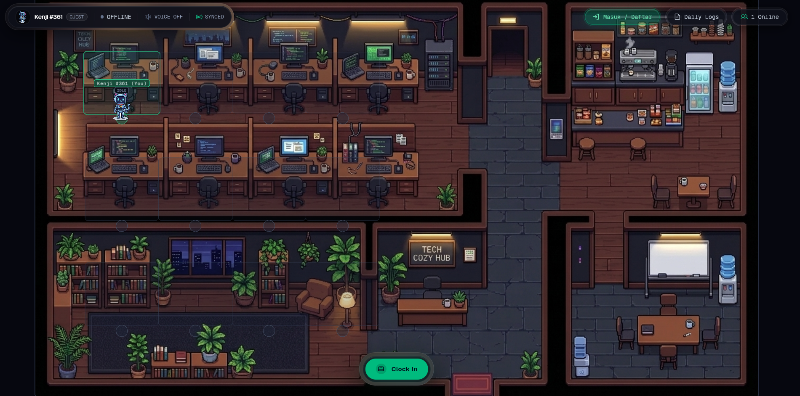

# Virtual Office (2D Presence Hub)

A lightweight 2D virtual presence hub for remote teams designed to cultivate social presence and facilitate spontaneous coordination without micromanagement or surveillance anxiety.

---



## Key Features

- **2D Canvas Office Viewport**:
  - Powered by PixiJS 8 with responsive top-down pixel sprite rendering.
  - Smooth avatar motion with linear interpolation (lerp).
  - Interactive virtual office layout with designated work desks and casual lounge zones.
  - Intelligent battery throttling: PixiJS ticker stops immediately when the browser tab is hidden or backgrounded.

- **Privacy-First & Ephemeral Realtime Presence**:
  - Live avatar coordinates (x, y) and status states broadcast via Cloudflare Durable Objects WebSocket.
  - Cached transiently in Upstash Redis with a 60-second TTL.
  - Coordinates are never logged or stored in PostgreSQL.
  - Adaptive heartbeat rate throttling (20Hz when active tab, down to 0.03Hz when hidden).

- **Bubble Chat & Spontaneous Communication**:
  - Floating chat input bar (open anytime using the `C` keyboard shortcut).
  - Pixel speech bubbles render directly above avatar heads on the canvas with smooth auto-fadeout.
  - Ephemeral messaging broadcast in real-time across the room.

- **Spatial Proximity & Audio**:
  - Real-time Euclidean distance calculation between avatars to detect social gathering.
  - Visual indicators for spatial proximity and quick microphone mute/unmute controls.

- **Character & Identity Customization**:
  - 6 distinct pixel art character sprites with live previews.
  - Display name customization with local storage and account persistence.

- **Attendance System & Daily Work Summary**:
  - **Clock-In**: Check in and automatically seat at an available desk.
  - **Presence States**: Seamlessly toggle between Working, Focus (DND), and Break states.
  - **Clock-Out with Tiptap Rich Text Editor**: Integrated modal powered by Tiptap (Bold, Italic, Strikethrough, Code, Bullet List, Numbered List, and auto-detect PR/task links).
  - **Daily Reports History**: Modal viewer to browse team work summaries for transparency.

- **Authentication (Better Auth)**:
  - Clean session and credentials management powered by Better Auth.
  - Securely synced with Neon Serverless PostgreSQL.

- **Hardware Aesthetics & Anti-AI Slop Guidelines**:
  - Doppelrand (nested bezel) ethereal glass design with dark graphite palette (`#05070f`, `#0b0f19`).
  - Crisp typography using Geist Variable and Geist Mono Variable.
  - Consistent icon sets from `@phosphor-icons/react`.

---

## Monorepo Architecture

Managed with **moon** and **pnpm workspaces**:

```text
virtual-office/
├── apps/
│   ├── api/          # Edge Hono API + Durable Objects + Upstash Redis (Cloudflare Workers)
│   └── web/          # React 19 + Vite + TanStack Router & Query + PixiJS 8 + Tailwind CSS v4
├── packages/
│   ├── database/     # Drizzle ORM + Neon Serverless PostgreSQL + Better Auth
│   └── schemas/      # Zod validation contracts for presence, chat, and attendance
└── Makefile          # Local development task runner
```

---

## Tech Stack

| Layer                | Technologies                                         |
| :------------------- | :--------------------------------------------------- |
| **Monorepo**         | Moon Repo, PNPM Workspaces, Biome                    |
| **Frontend**         | React 19, Vite, TanStack Router, TanStack Query      |
| **2D Engine**        | PixiJS 8 (Canvas / WebGL)                            |
| **Styling**          | Tailwind CSS v4, Geist Variable Font, Phosphor Icons |
| **Rich Text Editor** | Tiptap (StarterKit, Placeholder, Link)               |
| **Backend API**      | Hono, oRPC, Better Auth                              |
| **Edge Runtime**     | Cloudflare Workers & Cloudflare Durable Objects      |
| **Realtime Cache**   | Upstash Redis (REST)                                 |
| **Database**         | Neon Serverless PostgreSQL, Drizzle ORM              |
| **Validation**       | Zod v4                                               |

---

## Environment Setup (.env)

### 1. `apps/api/.dev.vars`

Create an `apps/api/.dev.vars` file for local worker configuration:

```env
DATABASE_URL=postgresql://<user>:<password>@<neon-host>/neondb?sslmode=require
UPSTASH_REDIS_REST_URL=https://<your-upstash-redis>.upstash.io
UPSTASH_REDIS_REST_TOKEN=<your-upstash-token>
WEB_ORIGIN=http://localhost:5173
BETTER_AUTH_URL=http://localhost:5173
BETTER_AUTH_SECRET=<your-random-secret-key-min-32-chars>
```

---

## Quick Start

### 1. Install Dependencies

```bash
make install
# or
pnpm install
```

### 2. Push Database Schema

```bash
make db-push
```

### 3. Start Development Servers

Run both API (Cloudflare Workers) and Web (Vite) concurrently:

```bash
make dev
```

- Web Client: `http://localhost:5173`
- API Worker: `http://localhost:8787`

---

## Makefile Commands

| Command          | Description                                            |
| :--------------- | :----------------------------------------------------- |
| `make dev`       | Run API worker and Vite dev server concurrently        |
| `make dev-api`   | Run Cloudflare Worker API server only                  |
| `make dev-web`   | Run React + PixiJS web frontend only                   |
| `make check`     | Run Biome linter and format verification               |
| `make format`    | Automatically format files with Biome                  |
| `make test`      | Run all Vitest test suites                             |
| `make build`     | Run type-checks and production builds across workspace |
| `make db-push`   | Push Drizzle schema changes to Neon PostgreSQL         |
| `make db-studio` | Open Drizzle Studio UI for database inspection         |
